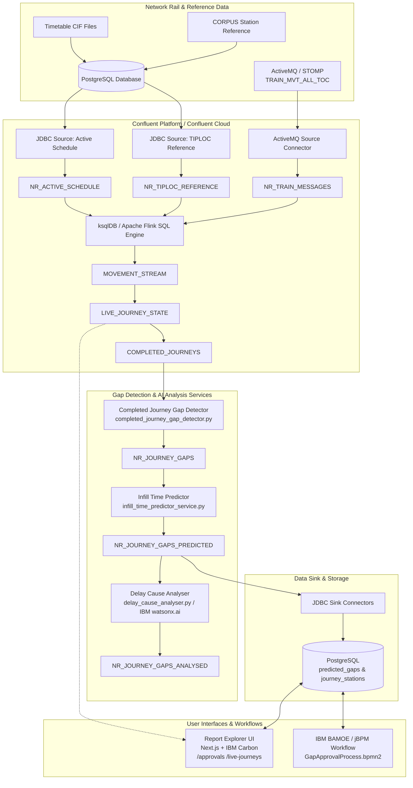

# Network Rail Gap Engine

Real-time train movement ingestion, missed-stop gap detection, ML-driven infill arrival/departure prediction, watsonx.ai delay cause analysis, and operator approval workflow for the UK rail network.

---

## 1. System Architecture & Data Flow



---

## 2. Repository Layout

```
networkrail-gap-engine/
├── gap_detector/                     # Python stream processing microservices
│   ├── completed_journey_gap_detector.py # Compares completed journeys against schedule
│   ├── infill_predictor.py           # Core infill prediction algorithms (4 strategies)
│   ├── infill_time_predictor_service.py # Stream service enriching gaps with predicted times
│   ├── delay_cause_analyser.py       # watsonx.ai LLM service for root cause classification
│   ├── Dockerfile.*                  # Container definitions for all Python services
│   └── requirements.txt              # Python dependencies (kafka-python, psycopg2, ibm-watsonx-ai)
├── confluent-setup/                  # Streaming infrastructure deployment & DDL
│   ├── deploy.sh                     # Interactive deployment script (OpenShift or Cloud)
│   ├── 00-connect-cr.yaml            # Kafka Connect Cluster CR
│   ├── 02-connectors-cr.yaml         # OpenShift source connector CRs
│   ├── 03-ksqldb-streams-and-tables.sql # Core ksqlDB transformation topology
│   ├── 04-create-topics.sh           # Topic creation script for OpenShift
│   ├── 05-predicted-gaps-sink-pipeline.sql # ksqlDB pipeline for flattening predictions
│   ├── 06-connector-predicted-gaps-sink.json # JDBC sink connector for predicted_gaps
│   ├── 07-connector-journey-stations-sink.json # JDBC sink for station visits
│   ├── cloud/                        # Confluent Cloud automated CLI scripts
│   │   ├── topics.sh                 # Confluent Cloud topic provisioner
│   │   ├── ksqldb.sh                 # ksqlDB DDL execution via REST API
│   │   ├── connectors.sh             # Confluent Cloud Connect REST provisioner
│   │   └── timetable-to-kafka/       # Direct CIF/CORPUS streaming publisher without DB
│   └── flink-cloud/                  # Apache Flink SQL alternative pipeline for Confluent Cloud
├── timetable/                        # Timetable & reference data ingestion tools
│   ├── load_corpus.py                # Loads CORPUS station reference JSON into PostgreSQL
│   ├── load_cif_json_fast.py         # Fast JSON CIF timetable parser & loader
│   ├── load_schedules_streaming.py   # Streaming schedule loader for large CIF files
│   ├── populate_stanox_arrays.py     # Backfills missing STANOX sequences on active schedules
│   └── refresh_schedules.sh          # Download and refresh daily schedules from Network Rail
├── stomp_client/                     # Standalone STOMP-to-Kafka bridge client
│   ├── main.py                       # Connects to Network Rail ActiveMQ and forwards to Kafka
│   └── Dockerfile                    # Container definition for stomp-client
├── exploration_ui/                   # Frontend applications
│   └── report-explorer/              # Next.js 16 + IBM Carbon Design System dashboard
│       ├── src/app/approvals/        # Operator infill gap approval/rejection UI
│       ├── src/app/live-journeys/    # Real-time train tracking dashboard
│       ├── src/app/gap-analytics/    # Historical gap trends and pattern analysis
│       └── db/migrations/            # Incremental PostgreSQL database migrations
├── gap_engine/kie/                   # IBM BAMOE / jBPM workflow engine integration
│   ├── src/main/resources/.../       # GapApprovalProcess.bpmn2 process definition
│   ├── gap-approval-starter.js       # Node.js service initiating workflows for pending gaps
│   └── pom.xml                       # Maven build configuration for KIE JAR
├── k8s/                              # Kubernetes / OpenShift manifests
│   ├── init-db.sql                   # Full PostgreSQL initialization schema
│   ├── secrets.yaml                  # OpenShift secret templates
│   ├── postgresql.yaml               # PostgreSQL database Deployment & Service
│   ├── completed-journey-gap-detector.yaml # Deployment for gap detector service
│   ├── infill-predictor.yaml         # Deployment for infill predictor service
│   ├── delay-cause-analyser.yaml     # Deployment for watsonx delay cause analyser
│   ├── frontend.yaml                 # Deployment, Service & Route for Next.js frontend
│   └── deployments.yaml              # Deployment for stomp-client bridge
├── build-and-deploy-images.sh        # Build container images and push to OpenShift registry
└── deploy-standalone-gap-detector.sh # Quick build & deployment for the gap detector service
```

---

## 3. Prerequisites

### Tools & CLIs
- **Container Engine**: [Podman](https://podman.io/) or [Docker](https://www.docker.com/)
- **Kubernetes / OpenShift CLI**: `oc` (v4.12+) or `kubectl`
- **Node.js**: v20.x or v22.x with `npm`
- **Python**: v3.10+ with `pip` and `venv`
- **Confluent CLI** *(only if deploying to Confluent Cloud)*: [Install Guide](https://docs.confluent.io/confluent-cli/current/install.html)

### External Credentials
- **Network Rail Data Feeds**: Account at [publicdatafeeds.networkrail.co.uk](https://publicdatafeeds.networkrail.co.uk/) subscribed to the `TRAIN_MVT_ALL_TOC` topic.
- **IBM watsonx.ai** *(optional for delay cause analysis)*: API key, Project ID, and endpoint URL.

---

## 4. Setup Guide

### Step 1: Clone Repository & Configure Secrets

1. Clone the repository and navigate to the project directory:
   ```bash
   git clone <repo-url>
   cd networkrail-gap-engine
   ```

2. Create the OpenShift project/namespace:
   ```bash
   oc new-project networkrail-gap-engine
   ```

3. Update [`k8s/secrets.yaml`](k8s/secrets.yaml) with your credentials:
   - `networkrail-credentials`: Network Rail feed username and password.
   - `postgresql`: Database user, password, and database name (`network_rail`).
   - `nextjs-auth`: Random 32-character authentication secret (`openssl rand -hex 32`).
   - `watsonx-credentials` *(optional)*: IBM Cloud API key and watsonx Project ID.

4. Apply secrets to the cluster:
   ```bash
   oc apply -f k8s/secrets.yaml -n networkrail-gap-engine
   ```

---

### Step 2: Database Setup (PostgreSQL)

1. **Deploy PostgreSQL on OpenShift**:
   ```bash
   oc apply -f k8s/postgresql.yaml -n networkrail-gap-engine
   oc rollout status deployment/postgresql -n networkrail-gap-engine --timeout=120s
   ```

2. **Initialize Schema**:
   Run [`k8s/init-db.sql`](k8s/init-db.sql) inside the PostgreSQL pod:
   ```bash
   PG_POD=$(oc get pod -l app=postgresql -n networkrail-gap-engine -o jsonpath='{.items[0].metadata.name}')
   oc exec -i "$PG_POD" -n networkrail-gap-engine -- psql -U postgres -d network_rail < k8s/init-db.sql
   ```

3. **Load Station Reference Data (CORPUS)**:
   Load the TIPLOC/STANOX station reference data:
   ```bash
   cd timetable
   python3 -m venv .venv && source .venv/bin/activate
   pip install -r requirements.txt
   
   # Set DB connection variables
   export POSTGRES_HOST="localhost"
   export POSTGRES_PORT=5432
   export POSTGRES_DB="network_rail"
   export POSTGRES_USER="postgres"
   export POSTGRES_PASSWORD="<password>"
   
   # If running from local machine against OpenShift DB, port-forward first:
   # oc port-forward svc/postgresql 5432:5432 -n networkrail-gap-engine
   
   python3 load_corpus.py
   ```

4. **Load Timetable Schedules (CIF)**:
   ```bash
   # Download CIF schedule extract and load into active_schedule table
   python3 load_cif_json_fast.py --file /path/to/cif_extract.json
   python3 populate_stanox_arrays.py
   cd ..
   ```

---

### Step 3: Streaming Infrastructure (Confluent)

You can deploy the streaming topology either to **Confluent Platform on OpenShift** or **Confluent Cloud**.

Run the unified deployment entrypoint:
```bash
./confluent-setup/deploy.sh
```

#### Option A: Confluent Platform on OpenShift (Self-Managed)
1. **Create Topics**:
   ```bash
   ./confluent-setup/04-create-topics.sh
   ```
2. **Deploy Source Connectors**:
   ```bash
   oc apply -f confluent-setup/02-connectors-cr.yaml -n confluent
   ```
3. **Execute ksqlDB Streams & Tables DDL**:
   Open **Confluent Control Center → ksqlDB → Editor** and run:
   - [`confluent-setup/03-ksqldb-streams-and-tables.sql`](confluent-setup/03-ksqldb-streams-and-tables.sql)
   - [`confluent-setup/05-predicted-gaps-sink-pipeline.sql`](confluent-setup/05-predicted-gaps-sink-pipeline.sql)
4. **Deploy JDBC Sink Connectors**:
   ```bash
   curl -X POST http://connect.confluent.svc:8083/connectors \
     -H 'Content-Type: application/json' \
     -d @confluent-setup/06-connector-predicted-gaps-sink.json

   curl -X POST http://connect.confluent.svc:8083/connectors \
     -H 'Content-Type: application/json' \
     -d @confluent-setup/07-connector-journey-stations-sink.json
   ```

#### Option B: Confluent Cloud (Managed)
Export your cloud credentials:
```bash
export CONFLUENT_CLOUD_ENV_ID="env-xxxxx"
export CONFLUENT_CLOUD_CLUSTER_ID="lkc-xxxxx"
export CONFLUENT_CLOUD_API_KEY="<api-key>"
export CONFLUENT_CLOUD_API_SECRET="<api-secret>"
export KSQLDB_ENDPOINT="https://<endpoint>.confluent.cloud:443"
export KSQLDB_API_KEY="<ksqldb-key>"
export KSQLDB_API_SECRET="<ksqldb-secret>"
export PG_HOST="<postgres-host>"
export PG_PASSWORD="<postgres-password>"
export NR_ACTIVEMQ_USERNAME="<nr-username>"
export NR_ACTIVEMQ_PASSWORD="<nr-password>"
```
Execute the cloud provisioners:
```bash
./confluent-setup/cloud/topics.sh
./confluent-setup/cloud/ksqldb.sh
./confluent-setup/cloud/connectors.sh
```
*(Alternatively, use the Flink SQL alternative documented in [`confluent-setup/flink-cloud/README.md`](confluent-setup/flink-cloud/README.md).)*

---

### Step 4: Build & Deploy Application Services

1. **Build and push images to the OpenShift registry**:
   ```bash
   ./build-and-deploy-images.sh
   ```
   This script builds for `linux/amd64` and pushes the following images:
   - `completed-journey-gap-detector:latest`
   - `infill-predictor:latest`
   - `stomp-client:latest`
   - `frontend:latest`

2. **Deploy Core Microservices to OpenShift**:
   ```bash
   # STOMP live feed bridge
   oc apply -f k8s/deployments.yaml -n networkrail-gap-engine

   # Stream processor: Gap Detector
   oc apply -f k8s/completed-journey-gap-detector.yaml -n networkrail-gap-engine

   # Stream processor: Infill Predictor
   oc apply -f k8s/infill-predictor.yaml -n networkrail-gap-engine

   # AI Delay Cause Analyser (optional, requires watsonx secret)
   oc apply -f k8s/delay-cause-analyser.yaml -n networkrail-gap-engine
   ```

3. **Verify running pods**:
   ```bash
   oc get pods -n networkrail-gap-engine
   ```

---

### Step 5: Frontend UI Setup (Report Explorer)

#### Deploy to OpenShift
```bash
oc apply -f k8s/frontend.yaml -n networkrail-gap-engine
```
Get the exposed route URL:
```bash
oc get route frontend -n networkrail-gap-engine -o jsonpath='{.spec.host}'
```

#### Run Frontend Locally for Development
1. Navigate to the frontend directory:
   ```bash
   cd exploration_ui/report-explorer
   ```

2. Create a local `.env.local`:
   ```bash
   POSTGRES_HOST=localhost
   POSTGRES_PORT=5432
   POSTGRES_DB=network_rail
   POSTGRES_USER=postgres
   POSTGRES_PASSWORD=postgres
   AUTH_SECRET=development-secret-must-be-32-chars-long
   NEXTAUTH_URL=http://localhost:3000
   ```

3. Install dependencies and start the dev server:
   ```bash
   npm install
   npm run dev
   ```
4. Access the web dashboard at `http://localhost:3000`. Key routes:
   - `/approvals` — Infill predictions review and approval queue.
   - `/live-journeys` — Real-time active train movement dashboard.
   - `/gap-analytics` — Route and station gap pattern analytics.
   - `/reports` — Journey performance and delay reporting.

---

### Step 6: IBM BAMOE BPMN Workflow (Optional)

The project includes an optional BPMN approval process ([`gap_engine/kie/src/main/resources/com/networkrail/gap/GapApprovalProcess.bpmn2`](gap_engine/kie/src/main/resources/com/networkrail/gap/GapApprovalProcess.bpmn2)) with automated 4-hour SLA auto-approval rules.

1. **Build KIE JAR**:
   ```bash
   cd gap_engine/kie
   mvn clean package
   ```
2. **Start Local KIE Container**:
   ```bash
   docker-compose up -d
   ```
3. **Run Process Starter**:
   ```bash
   node gap-approval-starter.js
   ```

---

## 5. Local Service Development

You can run individual Python stream processors locally against an existing Kafka and PostgreSQL instance:

```bash
cd gap_detector
python3 -m venv .venv && source .venv/bin/activate
pip install -r requirements.txt

# Create .env file
cat <<EOF > .env
KAFKA_BROKER=localhost:9092
INPUT_TOPIC=COMPLETED_JOURNEYS
OUTPUT_TOPIC=NR_JOURNEY_GAPS
CONSUMER_GROUP=local-gap-detector
AUTO_OFFSET_RESET=earliest
POSTGRES_HOST=localhost
POSTGRES_PORT=5432
POSTGRES_DB=network_rail
POSTGRES_USER=postgres
POSTGRES_PASSWORD=postgres
EOF

# Run Gap Detector
python3 completed_journey_gap_detector.py

# Run Infill Predictor in another terminal
python3 infill_time_predictor_service.py
```

---

## 6. Verification & Troubleshooting

### Check Pod Logs
```bash
# Real-time STOMP feed
oc logs -f deployment/stomp-client -n networkrail-gap-engine

# Gap detector logs
oc logs -f deployment/completed-journey-gap-detector -n networkrail-gap-engine

# Infill predictor logs
oc logs -f deployment/infill-predictor -n networkrail-gap-engine

# Next.js web application
oc logs -f deployment/frontend -n networkrail-gap-engine
```

### Inspect Kafka Topics
If using Confluent Operator on OpenShift:
```bash
oc exec -it -n confluent kafka-0 -- kafka-console-consumer \
  --bootstrap-server localhost:9092 \
  --topic NR_JOURNEY_GAPS_PREDICTED \
  --from-beginning \
  --max-messages 5
```

### Resetting Consumer Offsets
If you need to reprocess historical completed journeys from the beginning:
```bash
# Scale down detector
oc scale deployment/completed-journey-gap-detector --replicas=0 -n networkrail-gap-engine

# Reprocess with a new consumer group name in k8s/completed-journey-gap-detector.yaml
# or reset offsets using kafka-consumer-groups CLI

# Scale back up
oc scale deployment/completed-journey-gap-detector --replicas=1 -n networkrail-gap-engine
```

---

## 7. License

Licensed under the Apache License, Version 2.0.
