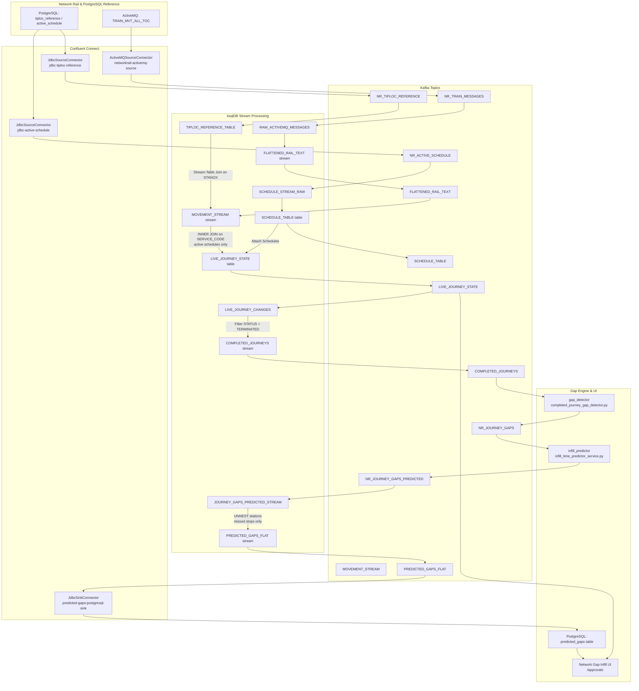

# Confluent Platform Architecture & Setup Guide

This guide documents the Confluent Platform topology on OpenShift, explains how `LIVE_JOURNEY_STATE` and `COMPLETED_JOURNEYS` are constructed, and provides step-by-step instructions to enrich messages with human-readable **station names**.

---

## 1. Overview & Data Flow Topology



---

## 2. Naming Convention

All names use **SCREAMING_SNAKE_CASE** throughout — topics, streams, and tables.

**Rule**: Topics produced by connectors carry the `NR_` prefix. Topics produced internally by ksqlDB do not. Application-produced topics use the `NR_` prefix.

### Connectors (`platform.confluent.io/v1beta1`)

| CR Name | Class | Destination Topic | Key |
| :--- | :--- | :--- | :--- |
| `networkrail-activemq-source` | `ActiveMQSourceConnector` | `NR_TRAIN_MESSAGES` | String (message ID) |
| `jdbc-tiploc-reference` | `JdbcSourceConnector` | `NR_TIPLOC_REFERENCE` | `STANOX` (String) — via `ValueToKey` + `ExtractField$Key` |
| `jdbc-active-schedule` | `JdbcSourceConnector` | `NR_ACTIVE_SCHEDULE` | `SERVICE_CODE` (String) — via `ValueToKey` + `ExtractField$Key` |

### Kafka Topics

| Topic Name | Produced By | Key | Value Format | Description |
| :--- | :--- | :--- | :--- | :--- |
| `NR_TRAIN_MESSAGES` | `networkrail-activemq-source` | String | JSON | Raw ActiveMQ message envelopes from Network Rail. |
| `NR_TIPLOC_REFERENCE` | `jdbc-tiploc-reference` | `STANOX` (String) | JSON | Reference records with `STANOX`, `TIPLOC`, `THREE_ALPHA`, and `STATION_NAME`. |
| `NR_ACTIVE_SCHEDULE` | `jdbc-active-schedule` | `SERVICE_CODE` (String) | JSON | Timetable schedule lines with `STANOX_ARRAY`, `TIPLOC_ARRAY`, and `TIMING_DATA`. |
| `FLATTENED_RAIL_TEXT` | ksqlDB CSAS | String | JSON | Exploded rail movement/activation/cancellation event blocks. |
| `SCHEDULE_TABLE` | ksqlDB CSAS | `SERVICE_CODE` (String) | JSON | Compacted table of train timetable schedules. |
| `MOVEMENT_STREAM` | ksqlDB CSAS | `TRAIN_SERVICE_CODE` (String) | JSON | Station-enriched movement events partitioned by service code. |
| `LIVE_JOURNEY_STATE` | ksqlDB CSAS | `TRAIN_ID` (String) | JSON | Stateful aggregate — **active-schedule journeys only** (INNER JOIN with `SCHEDULE_TABLE`). |
| `COMPLETED_JOURNEYS` | ksqlDB CSAS | `TRAIN_ID` (String) | JSON | Emitted when a journey reaches `STATUS = 'TERMINATED'` — inherits active-schedule filter. |
| `NR_JOURNEY_GAPS` | `gap_detector` | `TRAIN_ID` (String) | JSON | Consolidated gap summaries (found vs not-found stops, scheduled vs actual times, inline predictions). |
| `NR_JOURNEY_GAPS_PREDICTED` | `infill_predictor` | `TRAIN_ID` (String) | JSON | Enriched gap records with `prediction_summary` block from `infill_time_predictor_service.py`. |

### ksqlDB Streams & Tables

| Name | Type | Backing Topic | Key | Notes |
| :--- | :--- | :--- | :--- | :--- |
| `RAW_ACTIVEMQ_MESSAGES` | Stream | `NR_TRAIN_MESSAGES` | String | Raw envelope ingestion |
| `FLATTENED_RAIL_TEXT` | Stream | `FLATTENED_RAIL_TEXT` | String | Exploded event blocks |
| `SCHEDULE_STREAM_RAW` | Stream | `NR_ACTIVE_SCHEDULE` | `SERVICE_CODE` (KEY) | Raw schedule feed — key declared in schema |
| `MOVEMENT_STREAM` | Stream | `MOVEMENT_STREAM` | `TRAIN_SERVICE_CODE` | Station-name enriched, partitioned by service code |
| `LIVE_JOURNEY_CHANGES` | Stream | `LIVE_JOURNEY_STATE` | `TRAIN_ID` | Change-stream view of the live table |
| `COMPLETED_JOURNEYS` | Stream | `COMPLETED_JOURNEYS` | `TRAIN_ID` | Terminated journeys — active-schedule only |
| `TIPLOC_REFERENCE_TABLE` | Table | `NR_TIPLOC_REFERENCE` | `STANOX` | STANOX → station name lookup |
| `SCHEDULE_TABLE` | Table | `SCHEDULE_TABLE` (CSAS) | `SERVICE_CODE` | Compacted schedule lookup — keyed by service code |
| `LIVE_JOURNEY_STATE` | Table | `LIVE_JOURNEY_STATE` (CSAS) | `TRAIN_ID` | Per-journey state, active-schedule filtered via INNER JOIN |

---

## 3. Active-Schedule Filtering

`LIVE_JOURNEY_STATE` is built with an **INNER JOIN** between `MOVEMENT_STREAM` and `SCHEDULE_TABLE`:

```sql
FROM MOVEMENT_STREAM m
INNER JOIN SCHEDULE_TABLE s ON m.TRAIN_SERVICE_CODE = s.SERVICE_CODE
```

This means:
- Any movement whose `TRAIN_SERVICE_CODE` does **not** match a `SERVICE_CODE` in `NR_ACTIVE_SCHEDULE` is silently dropped at this point.
- `LIVE_JOURNEY_CHANGES` mirrors `LIVE_JOURNEY_STATE`, so it carries only active-schedule journeys.
- `COMPLETED_JOURNEYS` is derived from `LIVE_JOURNEY_CHANGES`, so it also only ever contains active-schedule journeys. No additional filter is needed downstream.
- `NR_JOURNEY_GAPS` and `NR_JOURNEY_GAPS_PREDICTED` are derived from `COMPLETED_JOURNEYS`, so they are also implicitly filtered to active schedules.

> **Key alignment**: `SCHEDULE_TABLE` is keyed by `SERVICE_CODE` (string). The `jdbc-active-schedule` connector must produce `NR_ACTIVE_SCHEDULE` with a plain string key for this join to work. The connector uses `ValueToKey` + `ExtractField$Key` transforms on `service_code` — the same pattern as `jdbc-tiploc-reference`.

---

## 4. Populating Station Names into `LIVE_JOURNEY_STATE` and `COMPLETED_JOURNEYS`

By default, Network Rail train movements (`0003`) only supply `loc_stanox`. To attach the **actual station name** (e.g. `"BRIGHTON"`, `"HAYWARDS HEATH"`, `"THREE BRIDGES"`):

1. **Stream reference data from PostgreSQL**:
   `jdbc-tiploc-reference` streams `tiploc_reference` into `NR_TIPLOC_REFERENCE` keyed by `STANOX`.
2. **ksqlDB Stream-Table Join**:
   Movement events in `MOVEMENT_STREAM` are left-joined with `TIPLOC_REFERENCE_TABLE` on `LOC_STANOX = s.STANOX`.
3. **Structured Visit Objects**:
   `LIVE_JOURNEY_STATE` builds `STATIONS_VISITED` using structs containing `STATION_NAME`:
   ```json
   {
     "STANOX": "87980",
     "STATION_NAME": "BRIGHTON",
     "TIPLOC": "BRGHTN",
     "ACTUAL_TIME": "1789942320000",
     "EVENT": "DEPARTURE"
   }
   ```
4. **Completed Journeys Output**:
   When `STATUS = 'TERMINATED'`, `COMPLETED_JOURNEYS` carries this full enriched station array along with `SCHEDULED_TIPLOCS` and `SCHEDULED_TIMINGS`.

---

## 5. Setup & Deployment Instructions

### Quick start — choose your target

Run the deployment entrypoint and follow the prompt to choose between
**Confluent Platform on OpenShift** or **Confluent Cloud**:

```bash
./confluent-setup/deploy.sh
```

You can also skip the prompt by pre-setting `TARGET`:

```bash
TARGET=openshift ./confluent-setup/deploy.sh
TARGET=cloud     ./confluent-setup/deploy.sh
```

---

### Option A — Confluent Platform on OpenShift

The original self-managed deployment path.  Uses `oc`/`kubectl` and the
Confluent Operator CRDs (`platform.confluent.io/v1beta1`).

#### Step 1: Pre-create Kafka Topics

Run the topic provisioner **before** applying connectors or ksqlDB DDL:

```bash
./confluent-setup/04-create-topics.sh
```

This creates all `KafkaTopic` CRs and waits for them to reach `CREATED` state.

#### Step 2: Deploy Source Connectors

```bash
oc apply -f confluent-setup/02-connectors-cr.yaml -n confluent
```

Verify all three source connectors reach `RUNNING` state before continuing:

```bash
oc get connectors -n confluent
```

#### Step 3: Execute ksqlDB Streams & Tables DDL

Execute in order in **Confluent Control Center → ksqlDB → Editor**:

1. **Main pipeline** — [`03-ksqldb-streams-and-tables.sql`](03-ksqldb-streams-and-tables.sql)
2. **Predicted gaps sink pipeline** — [`05-predicted-gaps-sink-pipeline.sql`](05-predicted-gaps-sink-pipeline.sql)

> All statements use `SET 'auto.offset.reset' = 'earliest'`.

#### Step 4: Deploy the JDBC Sink Connectors

```bash
# Via Confluent Connect REST API
curl -X POST http://connect.confluent.svc:8083/connectors \
  -H 'Content-Type: application/json' \
  -d @confluent-setup/06-connector-predicted-gaps-sink.json

curl -X POST http://connect.confluent.svc:8083/connectors \
  -H 'Content-Type: application/json' \
  -d @confluent-setup/07-connector-journey-stations-sink.json
```

Or apply as a Confluent `Connector` CR if using the Confluent Operator.

#### Step 5: Verify the Approval UI

Open the **Network Gap Infill** UI at `/approvals` to see pending infill predictions grouped by journey, with predicted times and one-click Approve / Reject actions.

---

### Option B — Confluent Cloud

The managed SaaS deployment path.  Uses the [Confluent CLI](https://docs.confluent.io/confluent-cli/current/install.html) and the Confluent Cloud REST API.  Your PostgreSQL instance must be network-accessible from Confluent Cloud (e.g. via a public endpoint or VPC peering).

#### Prerequisites

1. Install the Confluent CLI and log in:
   ```bash
   confluent login
   ```
2. Select your environment and cluster:
   ```bash
   confluent environment use <env-id>
   confluent kafka cluster use <cluster-id>
   ```
3. Export the required variables (see table below).

#### Environment variables

| Variable | Required | Description |
|---|---|---|
| `CONFLUENT_CLOUD_ENV_ID` | ✅ | Environment ID, e.g. `env-abc123` |
| `CONFLUENT_CLOUD_CLUSTER_ID` | ✅ | Kafka cluster ID, e.g. `lkc-abc123` |
| `CONFLUENT_CLOUD_API_KEY` | ✅ | Confluent Cloud Kafka API key |
| `CONFLUENT_CLOUD_API_SECRET` | ✅ | Confluent Cloud Kafka API secret |
| `PG_HOST` | ✅ | PostgreSQL hostname reachable from Cloud |
| `PG_PASSWORD` | ✅ | PostgreSQL password |
| `PG_PORT` | — | PostgreSQL port (default: `5432`) |
| `PG_DATABASE` | — | Database name (default: `network_rail`) |
| `PG_USER` | — | Database user (default: `postgres`) |
| `NR_ACTIVEMQ_USERNAME` | ✅ | Network Rail datafeed username |
| `NR_ACTIVEMQ_PASSWORD` | ✅ | Network Rail datafeed password |
| `NR_ACTIVEMQ_URL` | — | ActiveMQ host (default: `datafeeds.networkrail.co.uk:61619`) |
| `KSQLDB_ENDPOINT` | ✅ | ksqlDB REST URL, e.g. `https://abc123.aws.confluent.cloud:443` |
| `KSQLDB_API_KEY` | ✅ | ksqlDB API key |
| `KSQLDB_API_SECRET` | ✅ | ksqlDB API secret |
| `CONFLUENT_SCHEMA_REGISTRY_URL` | ✅ | Schema Registry URL (needed for JSON_SR sink topics) |
| `CONFLUENT_SCHEMA_REGISTRY_KEY` | ✅ | Schema Registry API key |
| `CONFLUENT_SCHEMA_REGISTRY_SECRET` | ✅ | Schema Registry API secret |

#### Step 1: Create Kafka topics

```bash
./confluent-setup/cloud/topics.sh
```

Creates all 17 topics (connector-produced, ksqlDB-produced, app-produced, DLQs) using `confluent kafka topic create`.

#### Step 2: Apply ksqlDB DDL

```bash
./confluent-setup/cloud/ksqldb.sh
```

Splits [`03-ksqldb-streams-and-tables.sql`](03-ksqldb-streams-and-tables.sql) and [`05-predicted-gaps-sink-pipeline.sql`](05-predicted-gaps-sink-pipeline.sql) into individual statements and POSTs each one to the ksqlDB REST API.

Use `KSQLDB_DRY_RUN=true` to preview statements without executing:

```bash
KSQLDB_DRY_RUN=true ./confluent-setup/cloud/ksqldb.sh
```

#### Step 3: Register connectors

```bash
./confluent-setup/cloud/connectors.sh
```

Registers all five connectors (3 sources + 2 sinks) via the Confluent Cloud Connect REST API.  If a connector already exists its config is updated in-place.

#### Step 4: Verify the Approval UI

Open the **Network Gap Infill** UI at `/approvals` to see pending infill predictions grouped by journey, with predicted times and one-click Approve / Reject actions.
